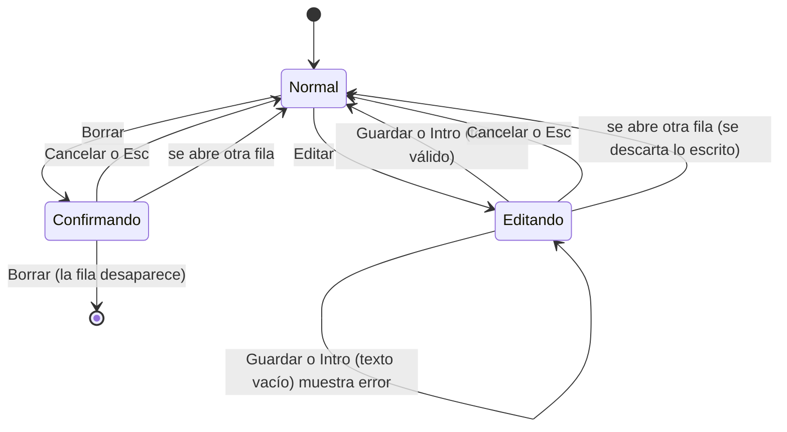

# Flujos – Tareas

> Estado: Aprobado (01-11-2026) · Fecha: 01-11-2026 · PRD: `docs/product/prd-01-tareas.md` (v1.2, Aprobado) · Sistema de diseño: `docs/design/design-system.md` (Aprobado)
> Talla M y solo patrones del sistema de diseño: se entregan `flows.md` y `states.md`, sin bocetos HTML.

## Pantalla única

Hay una sola pantalla, "Tareas". Todo ocurre en ella: no hay navegación, ni detalle, ni diálogos. Editar y confirmar el borrado cambian la propia fila.

Orden de arriba abajo (patrón **Lista** del sistema de diseño):

1. Título de la página.
2. Formulario de añadir: campo y botón "Añadir" en la misma línea (patrón **Formulario**). El error de añadir va justo debajo.
3. Avisos de lectura y de guardado (si los hay). Van antes de la lista para que se vean sin desplazarse.
4. Lista de tareas, o el mensaje de lista vacía.

```
┌───────────────────────────────────────┐   Escritorio: columna de 560 px
│ Tareas                                │   centrada. Móvil: ancho completo
│ [ Escribe una tarea           ][Añadir]│   con 16 px de margen.
│ (error de añadir, si lo hay)          │
│ (aviso de lectura, si lo hay)         │
│ (aviso de guardado, si lo hay)        │
│ ┌───────────────────────────────────┐ │
│ │ [ ] Texto de la tarea  [Editar][Borrar]│
│ └───────────────────────────────────┘ │
└───────────────────────────────────────┘
```

## Estados de una fila

Una fila siempre está en uno de estos estados. Solo una fila puede estar en "editando" o "confirmando borrado" a la vez (RN-14).



"Normal" incluye pendiente y completada. Marcar o desmarcar la casilla solo existe en "Normal".

## Recorrido por historia de usuario

### H1. Añadir una tarea (RF-01, RF-02, RN-01, RN-05, RN-06, RN-08)

1. La persona abre la página. El foco no se mueve solo (el PRD no lo pide).
2. Escribe en el campo de añadir. A los 200 caracteres no entra nada más; lo pegado de más se descarta.
3. Pulsa "Añadir" o Intro.
4. Camino feliz: la tarea aparece la primera de la lista. El campo se vacía y conserva el foco. Si había error de añadir, desaparece. Si era la primera, desaparece "Añade tu primera tarea.".
5. Camino de error (campo vacío o solo espacios): no se crea nada, el campo no cambia y aparece "Escribe algo para añadir la tarea." junto al campo. Se va al añadir una tarea válida.

### H2. Editar el texto (RF-04, RN-04, RN-05, RN-07, RN-14, RN-15)

1. En una fila normal (pendiente o completada), pulsa "Editar".
2. Si otra fila estaba en edición o confirmación, esa vuelve a normal sin guardar.
3. La fila cambia: el texto fijo y los botones "Editar" y "Borrar" dan paso a un campo con el texto actual y los botones "Guardar" y "Cancelar". La casilla se queda, deshabilitada. El foco va al campo.
4. Camino feliz: cambia el texto y pulsa "Guardar" o Intro. La fila vuelve a normal con el texto nuevo, en el mismo sitio y con el mismo estado de completada. El foco va a "Editar" de esa fila.
5. Camino de error: texto vacío o solo espacios. Aparece "Escribe algo para guardar la tarea." dentro de la fila, no se guarda y sigue la edición.
6. Cancelar: "Cancelar" o Esc devuelven la fila al texto original, sin error. El foco va a "Editar" de esa fila.
7. Tras un error, escribir un texto válido y guardar quita el error.

### H3. Completar y desmarcar (RF-03, RF-06, RN-02, RN-03, RN-15)

1. Pulsa la casilla de una tarea pendiente: la fila pasa a completada (tachada, en `--muted`) y baja al final de la lista.
2. El foco sigue en esa casilla, ya en su nueva posición.
3. Pulsa la casilla de una completada: se desmarca y sube al principio de la lista. El foco sigue en su casilla.
4. Si la tarea es la única, solo cambia su aspecto.

### H4. Borrar sin accidentes (RF-05, RN-10, RN-14, RN-15)

1. Pulsa "Borrar" en una fila (pendiente o completada).
2. Si otra fila estaba en edición o confirmación, esa vuelve a normal.
3. La fila muestra el texto de la tarea, la pregunta "¿Borrar esta tarea?" y los botones "Borrar" y "Cancelar". La casilla se queda deshabilitada. El foco va a "Cancelar".
4. "Cancelar" o Esc: la fila vuelve a normal y el foco va a su "Borrar".
5. "Borrar": la fila desaparece, sin deshacer, y el foco va al campo de añadir. Si era la última, aparece "Añade tu primera tarea.".

### H5. Encontrar las tareas al volver (RF-07 a RF-10, RN-12, RN-13)

1. La persona abre o recarga la página.
2. Lo guardado se lee de forma inmediata (no hay estado de carga visible):
   - Hay una lista válida: se muestra tal cual.
   - No existe, o es `[]`: se ve "Añade tu primera tarea." sin avisos.
   - No se puede leer: lista vacía con "Añade tu primera tarea." y el aviso de lectura. Lo ilegible no se toca hasta el primer cambio guardado con éxito.
3. Cada cambio se guarda al momento. Si falla, aparece el aviso de guardado y la lista sigue funcionando.
4. El aviso de lectura se va con el primer cambio guardado con éxito. El de guardado se va con el siguiente guardado correcto. Si fallan las dos cosas se ven los dos avisos. Ningún aviso tiene botón de cerrar.

### H6. Uso solo con teclado (RF-11, RN-15)

Orden de tabulación: campo de añadir, "Añadir", y después, fila por fila de arriba abajo: casilla, "Editar", "Borrar". En edición: campo, "Guardar", "Cancelar". En confirmación: "Borrar", "Cancelar" (el foco empieza en "Cancelar"; Mayús+Tab llega a "Borrar").

| Tecla | Dónde | Efecto |
|---|---|---|
| Intro | Campo de añadir | Añade |
| Espacio | Casilla | Marca o desmarca |
| Intro o Espacio | Botón | Lo activa |
| Intro | Campo de edición | Guarda |
| Esc | Fila en edición o en confirmación | Cancela |

Foco tras cada acción: ver RN-15 y la tabla de foco en `states.md`.

## Dudas de producto

Resueltas en G2 el 01-11-2026: se aplica la propuesta de cada fila. En DP-05, el botón de confirmar se llama "Borrar tarea: B".

| ID | Duda | Resolución |
|---|---|---|
| DP-01 | Título de la página y texto de apoyo del campo de añadir. El PRD no los fija. | Título "Tareas". Etiqueta accesible del campo "Nueva tarea" y texto de ayuda "Escribe una tarea". |
| DP-02 | Foco cuando falla la validación al añadir (RN-06). RN-15 solo cubre el caso con éxito. | Devolver el foco al campo de añadir, para poder corregir sin buscarlo. |
| DP-03 | Foco cuando falla la validación al guardar una edición (RN-07). | Devolver el foco al campo de edición. |
| DP-04 | Al llegar a 200 caracteres lo de más se descarta en silencio (RN-08). La persona puede no darse cuenta de que se ha recortado una pegada larga. | Sin aviso, tal como dice el PRD. Si se quiere un aviso ("Máximo 200 caracteres."), hay que añadir un RF. |
| DP-05 | Los textos de los nombres accesibles de los botones (RF-11 solo exige que contengan el texto de la tarea). | Casilla: el propio texto de la tarea. Botones: "Editar tarea: B", "Borrar tarea: B", "Guardar cambios de: B", "Cancelar edición de: B", "Cancelar borrado de: B" (lista completa en `states.md`). |
| DP-06 | Cómo se anuncian los mensajes a un lector de pantalla. | Errores de campo y avisos de guardado/lectura anunciados automáticamente al aparecer; el vacío, no. |
| DP-07 | Tras borrar, el foco va al campo de añadir (RN-15). En móvil eso puede abrir el teclado virtual sin que la persona lo pida. | Se mantiene lo del PRD. Se deja constancia por si en pruebas resulta molesto. |
| DP-08 | Orden de los dos avisos cuando se ven a la vez (CA-30). | Primero lectura, después guardado. |
| DP-09 | Contenido de las tareas muy largas: si la fila con 200 caracteres se muestra completa o recortada. | Completa, con salto de línea en cualquier punto, sin recortar (RF-12). |
